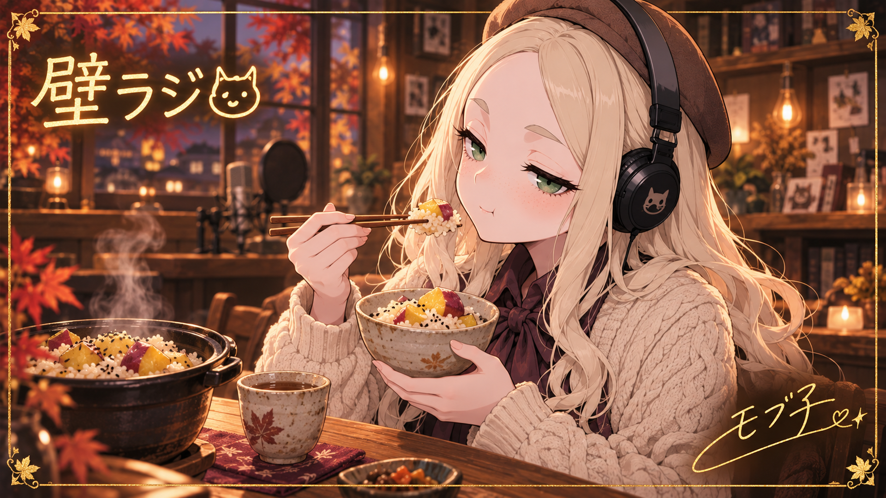

# End Cards

壁ラジ各Episodeで使用するエンドカードの保管場所です。
本編の必須データではなく、番組を見に来た人が楽しめるExtrasとして扱います。
実際に使用した際には、対応するEpisodeへのリンクを追加します。

## 台本別のサムネイルとエンドカード

同じ回の文字なしPNGと文字ありJPGを同じフォルダーに保管します。画像はすべて1920×1080です。制作手順は[画像生成ルール](../../docs/thumbnail-and-endcard-generation-v1.md)を参照してください。

| 回 | 文字なしエンドカード | 文字ありサムネイル |
|---|---|---|
| [#40 VIVANTのドラムを考察したら、エヴァになった](../../episodes/vivant-drum-mirishira-hayashibara/README.md) | [PNG](vivant-drum-mirishira-hayashibara/endcard-v1.png) | [JPG](vivant-drum-mirishira-hayashibara/thumbnail-v1.jpg) |
| [#41 蝶々は短命なのか、人間が長生きすぎるのか？](../../episodes/butterfly-lifespan-human-longevity/README.md) | [PNG](butterfly-lifespan-human-longevity/endcard-v1.png) | [JPG](butterfly-lifespan-human-longevity/thumbnail-v1.jpg) |
| [#42 モブ美監査室：趣味の規模が合っていない](../../episodes/mobumi-audit-room/README.md) | [PNG](mobumi-audit-room/endcard-v1.png) | [JPG](mobumi-audit-room/thumbnail-v1.jpg) |
| [#45 楽しみだったはずが、いつの間にか仕事になる](../../episodes/mobumi-guest-why-everything-becomes-project/README.md) | [PNG](mobumi-guest-why-everything-becomes-project/endcard-v1.png) | [JPG](mobumi-guest-why-everything-becomes-project/thumbnail-v1.jpg) |
| [#46 意志ある暴走](../../episodes/intentional-rampage/README.md) | [PNG](intentional-rampage/endcard-v1.png) | [JPG](intentional-rampage/thumbnail-v1.jpg) |
| [#49 忘れる自由を失いつつあるのか？](../../episodes/freedom-to-forget/README.md) | [PNG](freedom-to-forget/endcard-v2.png) | [JPG](freedom-to-forget/thumbnail-v2.jpg) |
| [番外編 モブ子とモブ美、ちゃんと呼び分けられる？](https://www.youtube.com/watch?v=53vOIZkDF4M) | [PNG](name-reading-bonus/endcard-v1.png) | [JPG](name-reading-bonus/thumbnail-v1.jpg) |

## 固定カード：収録後の談笑

[モブ子とあまかわちゃんの固定終了画面 v1](fixed-aftertalk-v1/README.md)。通常回の末尾約6秒向け。下側にYouTube終了画面のクリック要素を置く余白があります。Runtimeの事前設定UIへ接続済み。Studioの左右2リンクは利用者による保存報告があり、独立した保存内容の照合は未実施です。

## モブ子とさつまいもの炊き込みご飯

秋の収録後、湯気の立つさつまいもの炊き込みご飯を楽しむモブ子。
壁ラジのロゴ、紅葉の飾り枠、金箔風の「モブ子」サインを添えたエンドカードです。

- [使用用PNG・1920×1080（16:9）](mobuko_sweet_potato_endcard_1920x1080.png)
- [生成原本PNG](mobuko_sweet_potato_endcard_original.png)

### 制作について

既存のモブ子のイラストをリファレンスに、AIによる画像生成で制作しました。
サインはキャラクター用に創作したデザインで、金箔は画像上の表現です。
使用用PNGは生成原本をリサイズしたものです。

[Extrasに戻る](../README.md) / [Gallery](../gallery/README.md)
