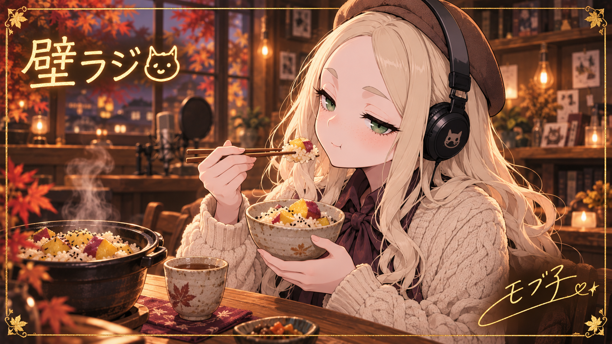

# End Cards

壁ラジ各Episodeで使用するエンドカードの保管場所です。
本編の必須データではなく、番組を見に来た人が楽しめるExtrasとして扱います。
実際に使用した際には、対応するEpisodeへのリンクを追加します。

## 固定カード：収録後の談笑

[モブ子とあまかわちゃんの固定終了画面 v1](fixed-aftertalk-v1/README.md)。通常回の末尾約6秒向け。下側にYouTube終了画面のクリック要素を置く余白があります。Runtimeの事前設定UIへ接続済み。Studioの左右2リンクは利用者による保存報告があり、独立した保存内容の照合は未実施です。

## モブ子とさつまいもの炊き込みご飯

秋の収録後、湯気の立つさつまいもの炊き込みご飯を楽しむモブ子。
壁ラジのロゴ、紅葉の飾り枠、金箔風の「モブ子」サインを添えたエンドカードです。

- [使用用PNG・1920×1080（16:9）](mobuko_sweet_potato_endcard_1920x1080.png)
- [生成原本PNG](mobuko_sweet_potato_endcard_original.png)

### 制作について

既存のモブ子のイラストをリファレンスに、AIによる画像生成で制作しました。
サインはキャラクター用に創作したデザインで、金箔は画像上の表現です。
使用用PNGは生成原本をリサイズしたものです。

[Extrasに戻る](../README.md) / [Gallery](../gallery/README.md)
