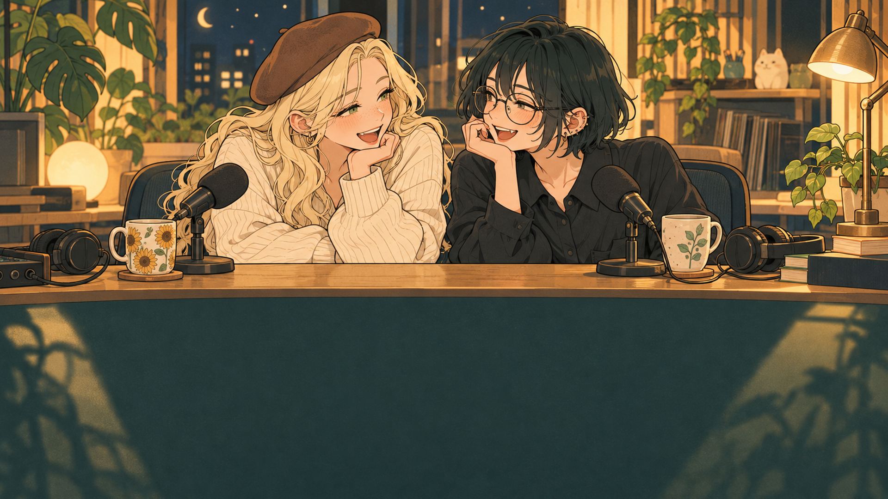

# 固定エンドカード：収録後の談笑 v1



左がモブ子、右があまかわちゃん。深夜ラジオの収録後、二人が机越しに談笑する固定終了画面用イラストです。

- [使用用PNG・1920×1080](endcard-1920x1080.png)
- [生成原本](endcard-original.png)
- [生成プロンプト](prompt.md)

内蔵image_genで2026-10-21に生成。原本を中央基準で16:9に微調整し1920×1080へリサイズしました。クリック要素や文字は画像に含めていません。

## 使用案

通常回の末尾6秒に表示。終了画面は次の2要素とします（2026-10-21 利用者指定）。

- 下側左：再生リスト「壁ラジ」
- 下側右：動画「視聴者に適したコンテンツ」（おすすめ動画をYouTubeが選択）

登録要素は含めません。人物の顔は上側に置いています。両要素は同じ最後の6秒に表示します。下側の余白に左右で配置し、Studioの配置制限とモバイル表示を確認して座標を確定します。Spike文書の3要素・中央登録案より本指定を優先します。

完成動画の末尾から6秒を要素の表示区間にします。ローカル確認動画はH.264/AAC、1080p、30fps、6秒で生成済み。Studioでの配置・保存・モバイル表示は未検証です。公開・投稿、Git commit/pushは今回行っていません。

## Runtimeへの接続（2026-10-21）

Assistantの配布用configへ `fixed-aftertalk-v1` プリセットと `assets/studio/endcard-fixed-aftertalk-v1.png` を追加し、通常ランチャー起動先にも反映しました。既存defaultプリセット（5秒）は保持しています。

```markdown
## Ending Sequence

[OUTRO: fixed-aftertalk-v1]
```

台本への指定は任意です。デスクトップRadioでは「レンダー・配信」→「出力条件」で、OP・アイキャッチと一緒にエンドカードを事前設定します。生成開始後のダイアログは廃止しました。通常の固定カードはOUTROがない台本でも本編→クレジット3秒→固定カード6秒になります（末尾計9秒）。

特別回は「画像→ぼかし」または「画像→固定カード」を選び、「画像を選ぶ…」で指定します。画像5秒→切り替え1秒→リンク用背景6秒。画像の管理コピーと選択はその台本だけに保存し、開き直すとサムネイル付きで復元します。通常・台本どおり・カードなしは次回以降の標準にも保存します。台本本文は変更せず、台本の移動・改名は別台本扱いです。管理画像が欠損・改変された場合は固定カードへ戻し、理由を表示・記録します。

新規Episodeテンプレートの必須OUTRO指定は取り消しました。Radioを開き直してから使用してください。Remote/CLIでは上記OUTRO指定を使用します。別端末には同じRuntime画像とプリセットが必要です。GitHubからの個別画像取得・ギャラリー連携は後続作業です。

選択内容・画像hash・表示時刻・リンク開始時刻は動画生成receiptへ保存します。開発側・通常起動先の両方でWPFメイン画面の選択・台本別保存復元・画像コピー・設定保全を確認しました。通常起動先では固定カードと特別回2方式の実レンダー、特別回＋OPの時刻、12レイアウトでの共通操作を確認済みです。実運用の全編TTS・Studioへの自動リンク保存は未検証です。

開発側と通常起動先それぞれの既存parser・event validation・Remote Outro resolver・Video rendererを用い、2秒の合成本編＋クレジット6秒＋カード6秒を実レンダーしました。全長14.000秒、H.264/AAC、1920×1080、30fps。9秒時点の抽出フレームで新カードを確認済みです。通常GUIでの全編TTS生成・実投稿は未検証です。

使用用PNG SHA-256: `f2121276405fbaa5ac4849b2fe11f51d165059c217e2e2a2ba8abe8fca391f18`

## クレジット短縮後の確認

開発側・通常起動先ともクレジット3秒へ変更し、2秒の合成本編＋credits3秒＋card6秒＝11秒で実レンダー・receiptを照合済みです。既存の完成動画・投稿済み動画は変更しません。新しい尺へ変更するにはRadioを開き直して明示的に再生成します。

終了画面テンプレート候補は `PIUcSHioslo`。利用者からStudioへの2リンク保存完了の報告あり。画像に合わせて左がプレイリスト、右がおすすめ動画の配置を共通案とします。保存内容・公開後維持の独立検証は未実施です。

[エンドカード一覧へ](../README.md)
