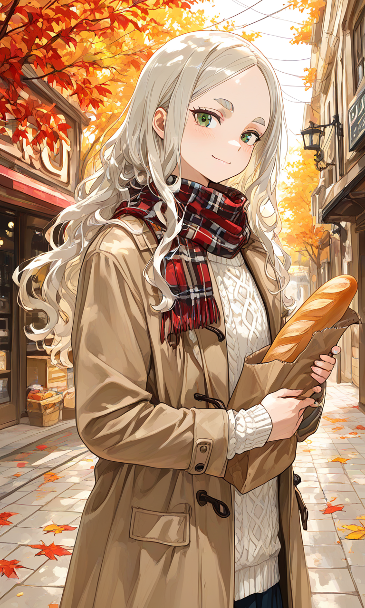
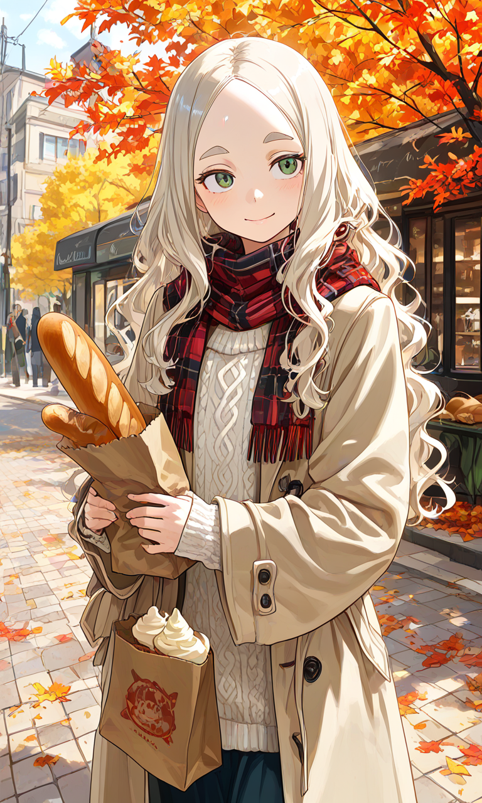
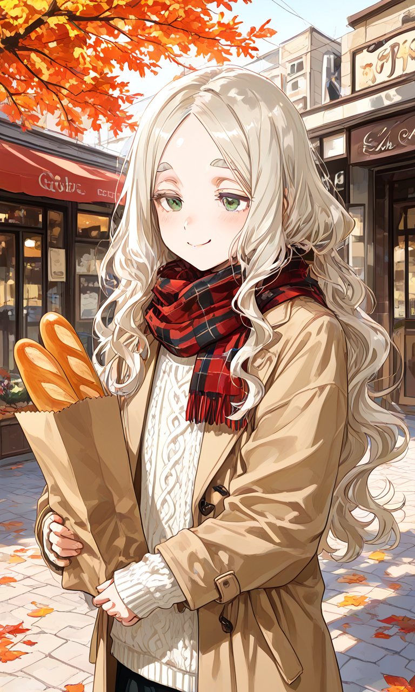

# つぶやき 2026-11-18

- 日付: 2026-11-18（水）
- 種別: 日常つぶやき
- シーン: 水曜日のお昼、駅前の商店街のパン屋さん帰り、焼きたてバゲットの紙袋を抱えて紅葉の通りを歩く
- 画像: mobuko_bakery_shopping_noon.png（推しとして仮採用した候補1 cand1.webp。ユーザーが反応で別の候補を選んだ場合は配信側で差し替える。候補4枚はローカルの pixai-sets/tweets/2026-11-18_bakery-shopping-noon/ に保管、生成タスク 2079631098333463245、seed 296158653648845、1,200クレジット）
- ハッシュタグ: #壁ラジ #ポッドキャスト #PixAI #パン屋さん
- X投稿: （リンク未確認。分かったらここに追記）

## 本文

お昼の買い物の帰りに、パン屋さんで焼きたてのバゲットを買いました。紙袋からいい匂いがして、紅葉の通りを歩く足取りまで軽くなります。お昼ごはんが楽しみです。
#壁ラジ #ポッドキャスト #PixAI #パン屋さん

## おまけ写真

生成候補4枚を、おまけ写真として併せて保管します。採用した1枚は cand1（= mobuko_bakery_shopping_noon.png）です。

