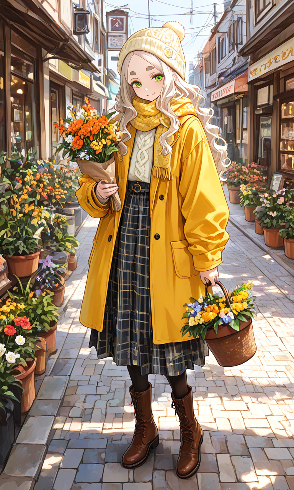
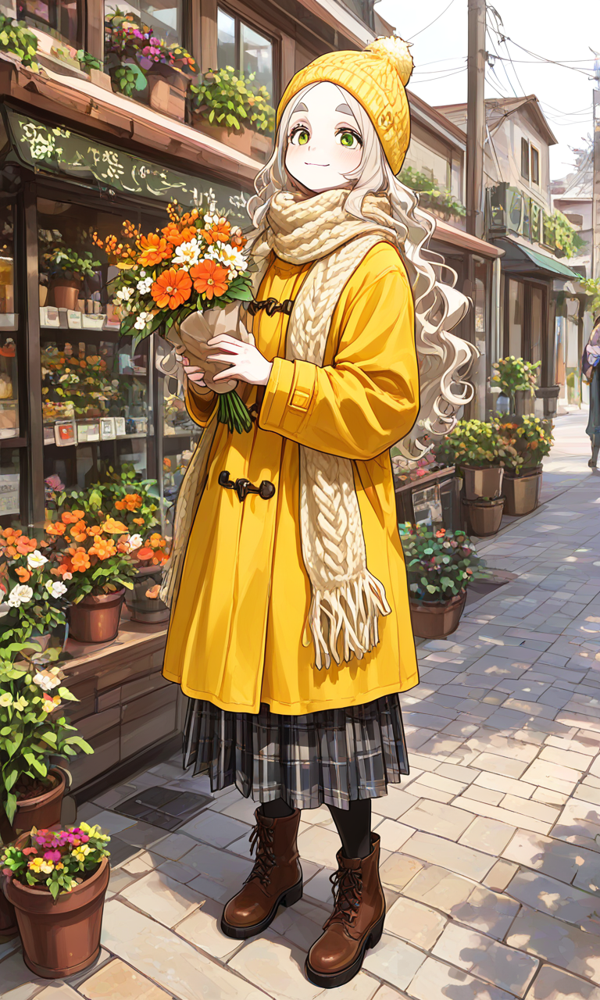

# つぶやき 2026-11-25

- 日付: 2026-11-25（水）
- 種別: 日常つぶやき
- シーン: 水曜日のお昼、商店街の小さな花屋さんで秋色の小花束を選び、両手で抱えて帰る
- 画像: mobuko_flower_shop_noon.png（推しとして仮採用した候補2 cand2.webp。ユーザーが反応で別の候補を選んだ場合は配信側で差し替える。候補4枚はローカルの pixai-sets/tweets/2026-11-25_flower-shop-noon/ に保管、生成タスク 2082167648174832140、seed 313582039940165、1,200クレジット）
- ハッシュタグ: #壁ラジ #ポッドキャスト #PixAI #花のある暮らし
- X投稿: （リンク未確認。分かったらここに追記）

## 本文

お昼に商店街の花屋さんで、小さな花束を選んできました。黄色いコートにオレンジのお花、なんだか元気な組み合わせです。お部屋に飾るのが楽しみです♪
#壁ラジ #ポッドキャスト #PixAI #花のある暮らし

## おまけ写真

生成候補4枚を、おまけ写真として併せて保管します。採用した1枚は cand2（= mobuko_flower_shop_noon.png）です。

