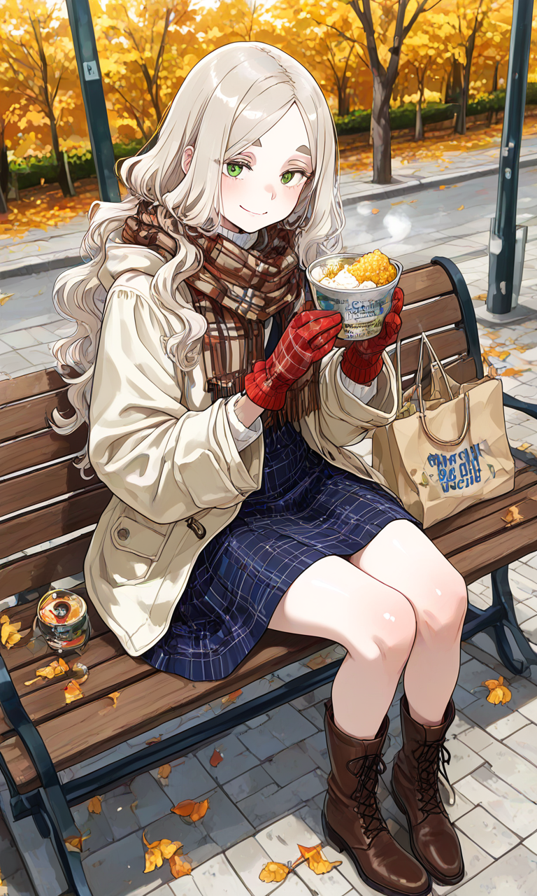
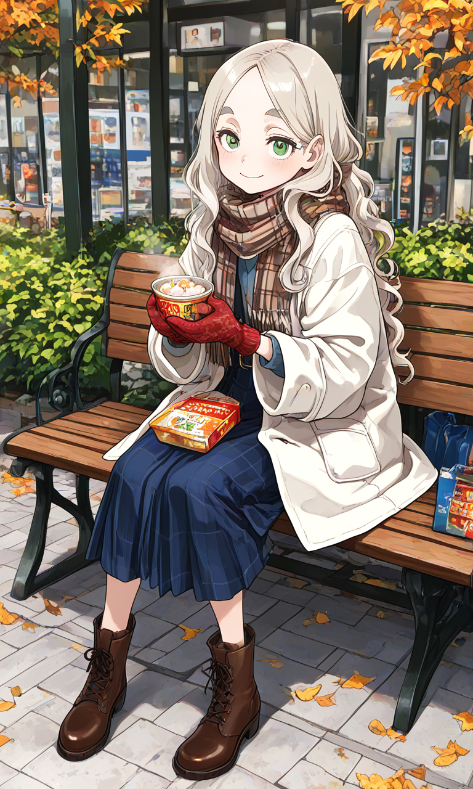
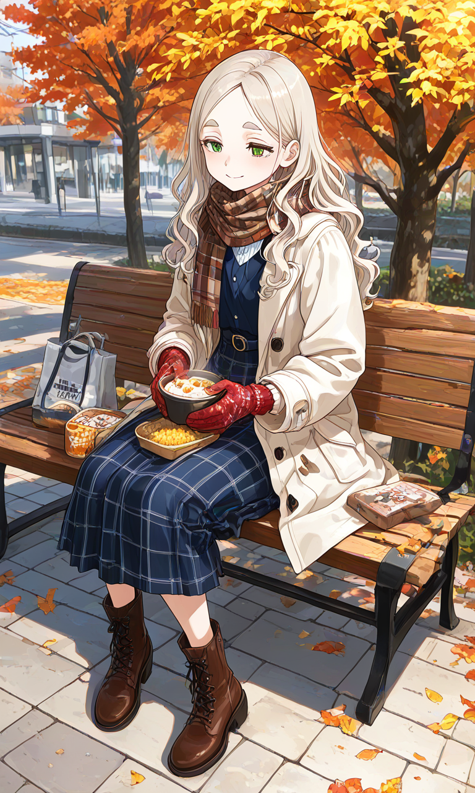
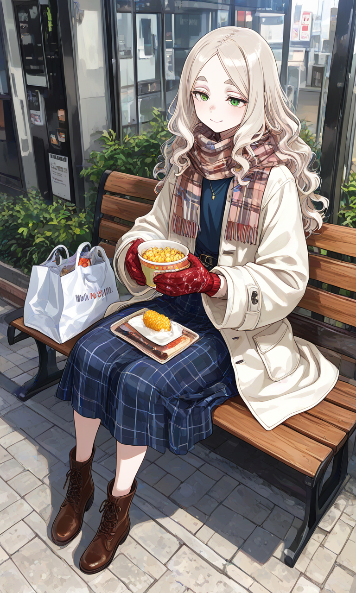

# つぶやき 2026-11-26

- 日付: 2026-11-26（木）
- 種別: 日常つぶやき
- シーン: 木曜日のお昼、駅前広場のベンチで温かいコーンスープを両手で持ってひと休み（晩秋の陽だまり）
- 画像: mobuko_warm_drink_bench_noon.png（当初推し cand1。ユーザーの反応により cand4 を採用確定し、2026-11-26 に配信側で差し替え済み。候補4枚はローカルの pixai-sets/tweets/2026-11-26_warm-drink-bench-noon/ に保管、生成タスク 2082529941446101623、seed 3388484247344451、1,200クレジット）
- ハッシュタグ: #壁ラジ #ポッドキャスト #PixAI #お昼休み
- X投稿: （リンク未確認。分かったらここに追記）

## 本文

お昼休みに駅前のベンチで、温かいコーンスープを両手で持ってひと休みです。手袋をしていても、じんわり温かさが伝わってくるのが嬉しいですね。午後の収録もがんばれそうです。
#壁ラジ #ポッドキャスト #PixAI #お昼休み

## おまけ写真

生成候補4枚を、おまけ写真として併せて保管します。採用した1枚は cand4（= mobuko_warm_drink_bench_noon.png）です。

