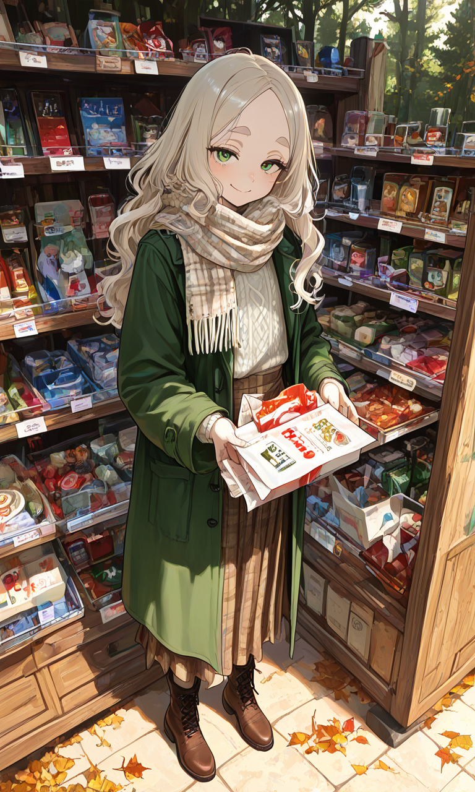
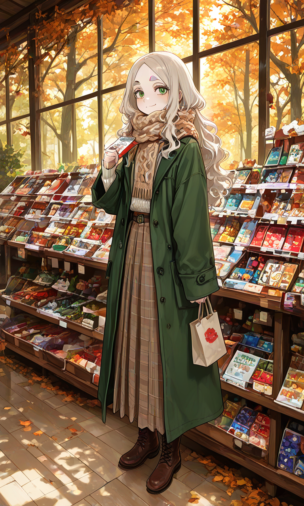
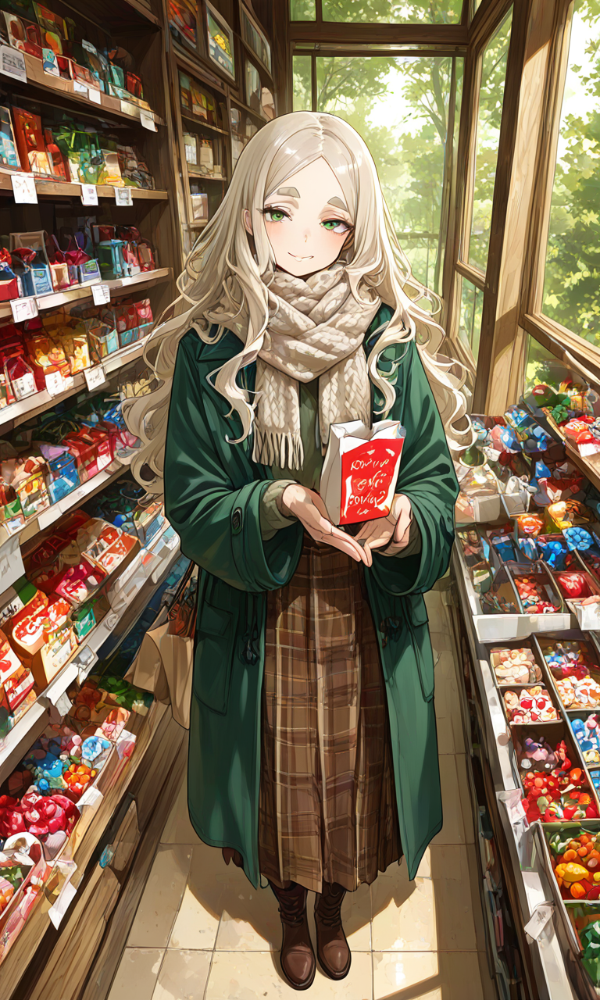
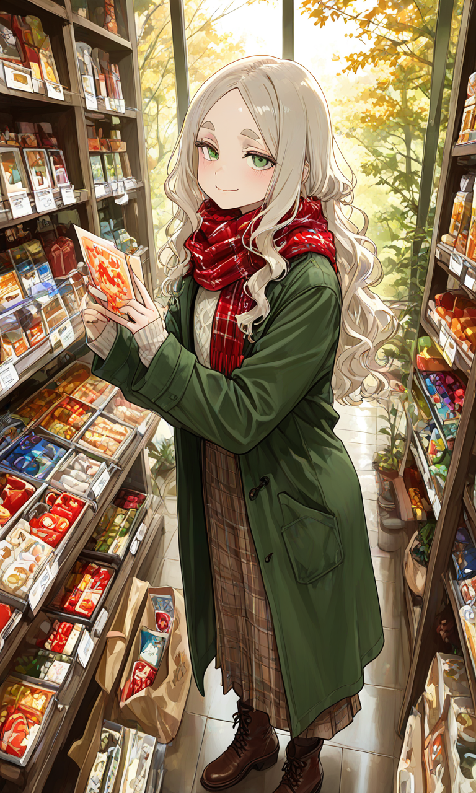
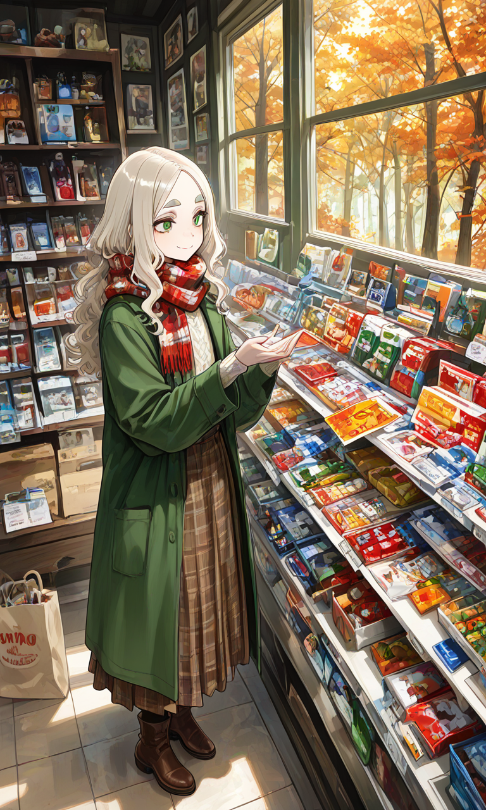
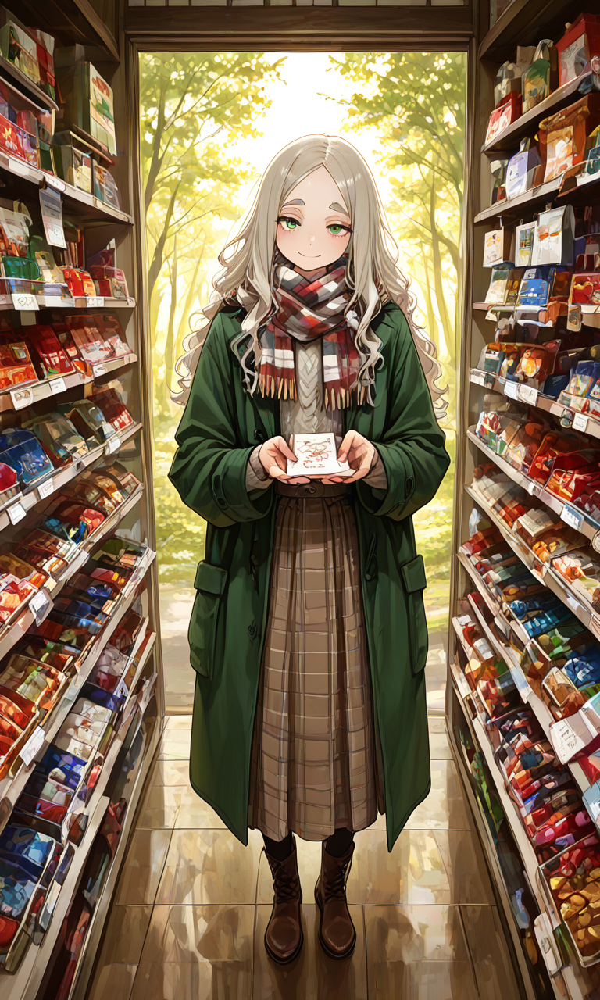

# つぶやき 2026-11-28

- 日付: 2026-11-28（土）
- 種別: 日常つぶやき
- シーン: 土曜日のお昼、小さな文具屋さんでクリスマスカードを選ぶ（晩秋、窓からの柔らかい日差し）
- 画像: mobuko_stationery_christmas_cards_noon.png（v2 cand2 を採用。経緯：初回生成（タスク 2083254723198062305、seed 5258585013697041）のプロンプトに full body が入っていてキャラが小さかったため、社長指示で full body を外して再生成（v2、タスク 2083264062486893024、1,200クレジット）。2026-11-28 社長が反応で v2 cand2 を選択し、採用画像を差し替えた。v1候補4枚は cand1〜4.png、v2候補4枚は v2cand1〜4.png として併せて保管）
- ハッシュタグ: #壁ラジ #ポッドキャスト #PixAI #クリスマスカード
- X投稿: （リンク未確認。分かったらここに追記）

## 本文

お休みの日のお昼に、文具屋さんでクリスマスカードを選んできました。赤いカードが可愛くて、つい長く眺めてしまいました。誰に送ろうか考える時間も、なんだか楽しいですね。
#壁ラジ #ポッドキャスト #PixAI #クリスマスカード

## おまけ写真

生成候補を、おまけ写真として併せて保管します。v1の候補4枚（cand1〜4）と、再生成v2の候補4枚（v2cand1〜4）です。採用した1枚は v2 cand2（= mobuko_stationery_christmas_cards_noon.png）です。

